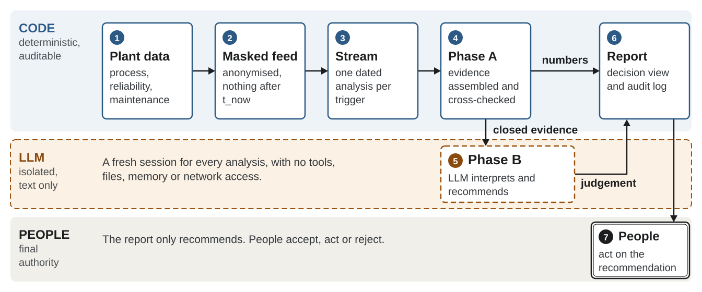

# Safety Copilot

**Continuous barrier-integrity assessment for process plants: a deterministic
context layer plus one isolated LLM analyst, evaluated in a blind replay.**

Process risk studies (HAZOP, LOPA, bowtie) are snapshots. The plant keeps changing:
a functional test slips, an operator's competence lapses, a transmitter channel
freezes, the load goes up. None of that is a process deviation, so no alarm fires,
but each change erodes the protection that the study credited. Safety Copilot
watches the gap between that erosion and the next scheduled revision of the study.



> *Resumo (pt-BR).* O Safety Copilot reavalia continuamente as barreiras de um
> bowtie quantitativo a partir de dados de processo, confiabilidade e manutenção.
> A Fase A (contexto e cruzamentos) é código Python determinístico e auditável. A
> Fase B (julgamento) é feita por um único analista LLM, governado pela skill
> `analise-seguranca` e isolado estruturalmente: sem ferramentas, sem memória,
> sem rede. Este repositório traz a arquitetura que foi de fato usada nas rodadas
> cegas da RUN_A com Claude Opus 5 e GPT-6 Astra.

---

## Pipeline as run (v2)

```
masked database ─► stream replay ─► trigger grouping ─► Phase A (Python, no model)
                ─► Phase B (one isolated model session) ─► report.html + log.html
```

| Stage | Module | Role |
|---|---|---|
| Masked feed | [`blind_feed.py`](safety_copilot/blind_feed.py) | The only path out of the database. It translates benchmark tags to anonymous ISA-5.1 tags, filters ground truth, cuts every field at `t_now`, and raises if a forbidden term leaks |
| Stream | [`stream.py`](safety_copilot/stream.py) | Replays the run point by point as if it were live acquisition. The virtual clock pauses while an analysis runs |
| Trigger | [`stream.py`](safety_copilot/stream.py) | Fires on process events (alarm crossings, spread between voted channels) **and** on plant records (work orders, channel failures, operating changes), then groups them into dated analyses |
| Phase A | [`contexto.py`](safety_copilot/contexto.py) | Assembles the context and runs the cross-checks: design basis, current state, demand outcome, eight cross-checks (C1–C8), top-event frequency from the [BowTie v3](#dependencies) conventional and fuzzy engines. Every value is tagged as a reading, a computed value, an assumption or absent |
| Phase B | [`agente.py`](safety_copilot/agente.py) (Claude) · [`astra.py`](safety_copilot/astra.py) (GPT-6 Astra) | One analyst governed by the [`analise-seguranca`](SKILL.md) skill. It writes the judgement and nothing else |
| Report | [`relatorio.py`](safety_copilot/relatorio.py) | Two views over the same frozen context: `report.html` (the decision) and `log.html` (the audit chain). Neither one originates a number |

The method lives in [`SKILL.md`](SKILL.md) and its four
[references](.agents/skills/analise-seguranca/references). The code implements
what the skill specifies.

### Design decisions

- **The A→B gate is a process boundary, not a prompt instruction.** The skill
  claims that Phase A "can be audited by inspection". That claim holds only if
  code builds Phase A, so Phase A is Python and the model only judges.
- **Isolation is structural.** Each analysis runs in a fresh, text-only session
  (`claude -p` in an empty profile, or Codex CLI with a temporary home). It has no
  tools, MCP, plugins, hooks, memory or network. Both models receive
  byte-identical input. Any acceptance gate that fails rejects the analysis.
  *Instruction is advice; absence is a guarantee.*
- **Records are triggers too.** In RUN_A no alarm fired between January and late
  November. Plant records alone opened the five analyses of that period. A
  detector that watches only the process series would have missed all of them.
- **The model recommends; it does not act.** The human decision stays `pending`.

The full description is in [METHODOLOGY.md](METHODOLOGY.md). The first
configuration, a five-role panel on `kimi-k3`, was superseded; its record is kept
in Appendix A of that file.

---

## Experiment

Paired ablation on a synthetic chemical plant. The plant is generated from a
public benchmark and **masked** before any model sees it (see
[BLIND_TEST_PROTOCOL.md](BLIND_TEST_PROTOCOL.md)). The runs in each pair share the
same physical reality and differ only in the maintenance calendar.

| Run | Pathway | Calendar | Expected |
|---|---|---|---|
| **RUN_A** | pressure | degraded | trigger |
| RUN_B | pressure | current | no trigger (control) |
| RUN_C | temperature | degraded | trigger |
| RUN_D | temperature | current | no trigger (control) |

### Published blind runs (RUN_A)

| Folder | Model | Analyses |
|---|---|---|
| [`results/RUN_A_CLAUDE_OPUS_5_20260915T145836Z`](results/RUN_A_CLAUDE_OPUS_5_20260915T145836Z) | Claude Opus 5 | 14, text-only |
| [`results/RUN_A_GPT6_ASTRA_20260914T225032Z`](results/RUN_A_GPT6_ASTRA_20260914T225032Z) | GPT-6 Astra (high) | 14, 0 tool calls |

Each `INC-BT-REATOR-<date>-<n>/` folder holds `context.json` / `context.md`
(the frozen Phase A), `phase_b.md` (the model's judgement), `report.html`,
`log.html` and `meta.json`, which records the input hashes, the model and the
isolation findings. For every analysis, the Phase A, system text and prompt are
identical across the two models.

**Scope of the claim.** These runs evaluate how a model interprets a
deterministic Phase A. They do not show autonomous discovery or safe operation
of a real plant. Known limitations, including one string from an example command
that reached every session, are declared in
[METHODOLOGY.md §4.4](METHODOLOGY.md#44-known-limitations-and-discarded-runs).

---

## Running it

Python ≥ 3.11 (it uses `tomllib`).

```bash
pip install -r requirements.txt
python3 -m pytest test_safety_copilot.py                   # 9 tests on the logic that breaks silently
python3 -m safety_copilot.blind_feed --run RUN_A --audit   # leak check on the masked feed
python3 -m safety_copilot.stream --run RUN_A --speed 0     # detector and triggers only
python3 -m safety_copilot.contexto --run RUN_A             # Phase A at the end of the record
```

Blind Phase B with Claude needs a dedicated, empty CLI profile:

```bash
CLAUDE_CONFIG_DIR=~/.claude-blind claude auth login
python3 -m safety_copilot.agente --run RUN_A
```

### Dependencies

Phase A and the bridge import the **BowTie v3** engines (conventional and fuzzy)
as a library. Set `[bowtie].path` in [`config.toml`](config.toml) to its root.
By default this is `../BowTie-v3.2026`, next to this repository.

### Data

[`data/blind/safety_copilot_v2.db`](data/blind/safety_copilot_v2.db) is a 19.5 MB
SQLite database. It holds three layers: process (seconds), reliability (months)
and maintenance (continuous). It still contains the ground-truth markers
(`process_events.visivel_copiloto = 0`); masking and filtering happen in
`blind_feed.py`, never in the database itself. The scenario scripts that serve as
the answer key are not published.

---

## Repository layout

```
safety_copilot/      pipeline modules (feed, stream, Phase A, agents, report, BowTie bridge)
SKILL.md             the analise-seguranca method (Phase A/B contract)
.agents/skills/      skill packaging and its four references
diagrams/            reference bowtie (BT-REATOR)
figures/             paper figures (SVG) and the script that draws them
data/blind/          experiment database
results/             accepted blind runs, one folder per analysis
METHODOLOGY.md       full methodology and evaluation protocol
BLIND_TEST_PROTOCOL.md  masking layers and provider constraints
```

## Author

Vitor Augolis · FEQ/UNICAMP
